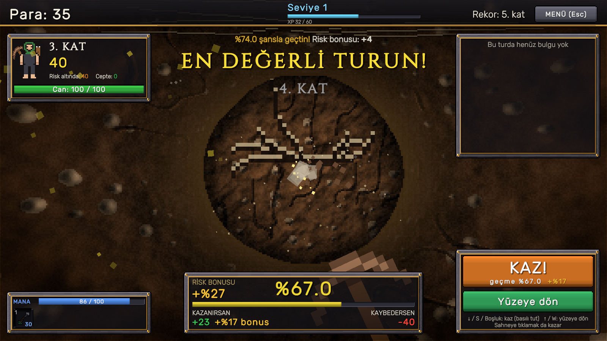
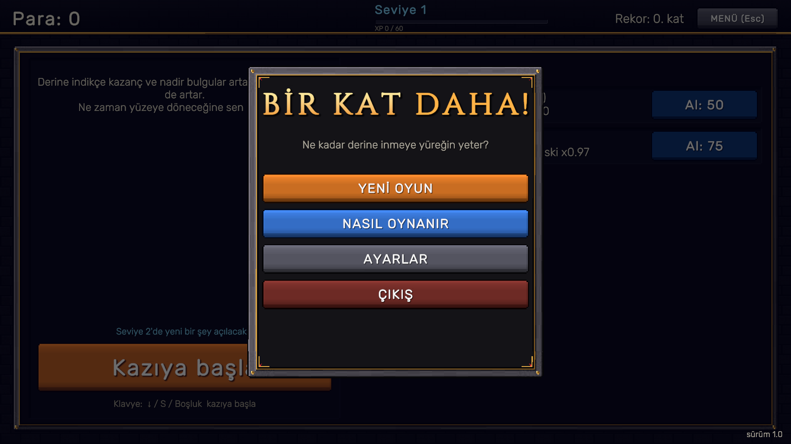
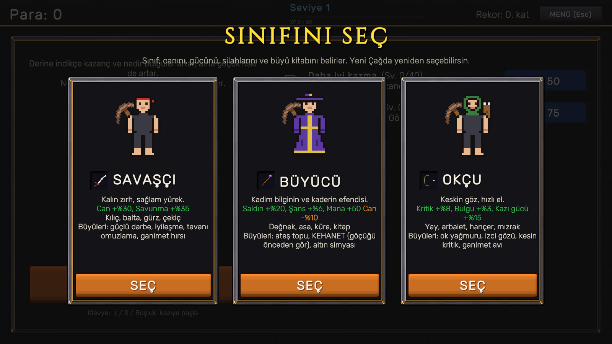
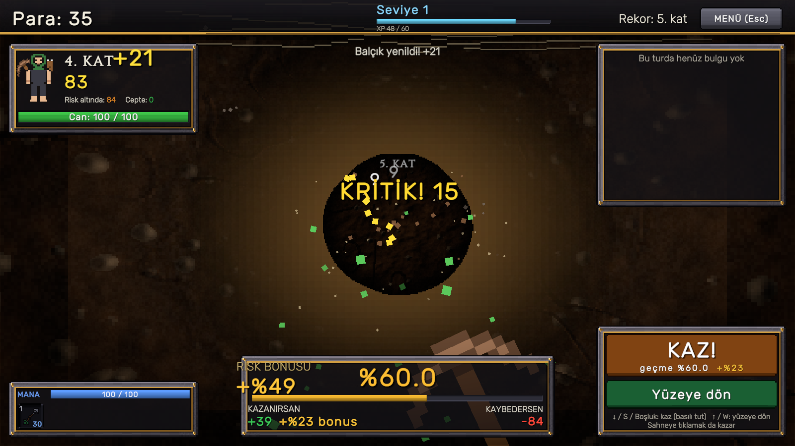
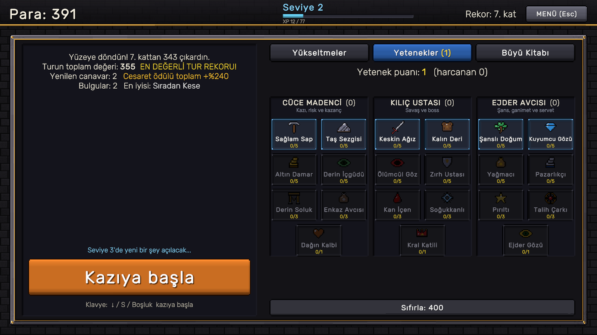

# Bir Kat Daha! (One More Floor!)

**A risk/reward digging game built in Unity 6 with C#.** Every floor you dig pays more, and every floor brings a bigger chance that the ceiling caves in and you lose everything from the run. Should you dig one more floor, or head back to the surface?

[Türkçe açıklama aşağıda](#türkçe)



| | |
|---|---|
|  |  |
|  |  |

## Features

- **Push-your-luck core loop:** dig deeper for growing rewards, or cash out safely. The risk bonus grows as you take on lower survival odds.
- **Zones and bosses:** every 10th floor holds a zone boss. The rock you dig changes from zone to zone: soil, stone, crystal, wet lake stone, iron, fossils, dragon scales, basalt and lava, the void.
- **RPG layer:** 3 classes (Warrior, Mage, Archer) with 6 spells each, a 21-node talent tree, 9 rarity tiers, gear with random affixes and item levels, enhancement from +1 to +10, and a prestige ("New Age") system.
- **Game feel:** hit-stop, screen shake, a celebration that escalates in 7 colors with risk, a heartbeat vignette, and a first-person 3D tunnel that moves forward as you break through.
- **No external art or audio:** all pixel art, the perspective tunnel, the UI skin and all 17 sound effects are generated in code.
- **Complete game shell:** main menu, pause menu, settings, tutorial, save system and a one-click Windows build.

## Technical highlights

- **Pure C# game core** (`Assets/Scripts/Core`, an assembly with `noEngineReferences: true`): all rules live in `GameSession` and `RiskMath`, with no Unity dependency. Randomness is injected (`IRandomSource`), so the core is deterministic and testable.
- **Data-driven balance:** every number lives in `BalanceData` (a ScriptableObject wrapper, exportable to JSON). The curves were tuned with Monte Carlo simulations of 200,000 runs.
- **Views only display:** UI views raise events, `GameController` bridges them to the core, and `RunFeedbackDirector` stages the results.
- **Scene built from code:** `RiskLoop > Build Prototype Scene` rebuilds and wires the whole UI. This keeps the scene reproducible and diff-friendly.
- **Procedural graphics:** a per-pixel perspective tunnel with height-map lighting and seamless wrapping, Voronoi rock faces, background-thread texture generation, and a 9-slice pixel-art UI skin exported as PNGs.
- **Automated visual testing:** `DevBuild` produces a test build from the command line, and `DevAutoShot` (`-autoshot <folder>`) plays the game by itself and captures screenshots to check UI changes.

## Project structure

```
Assets/Scripts/
  Core/    Game rules (pure C#): GameSession (+ Combat, Gear, Spells, Progression, Prestige), RiskMath, BalanceData
  Game/    Unity layer: GameController, RunFeedbackDirector, SaveSystem, UIStrings, Art/ (procedural art), UI/ (views)
  Editor/  Scene builder, UI skin and font generators, build tools
```

## Running the project

1. Open the folder with **Unity 6.6 (6000.6.6f1)**.
2. Run **RiskLoop > Build Prototype Scene**.
3. Press **Play**, or create a Windows build with **RiskLoop > Windows Sürümü Al (zip)**.

Controls: `↓ / S / Space` to dig (hold to repeat), `↑ / W` to return to the surface, `1-6` to cast spells, `Esc` to open the menu.

## Credits

- Fonts: [Cinzel](https://fonts.google.com/specimen/Cinzel) and [Rubik](https://fonts.google.com/specimen/Rubik) (SIL Open Font License, license files in `Assets/Fonts`).
- Developed with the help of AI pair programming (Claude Code). I made the game design decisions, set the direction and tested the game.

## License

Copyright © 2026 ahmetmithattatar. All rights reserved. The source code is published for viewing as a portfolio. See [LICENSE](LICENSE).

---

## Türkçe

**Unity 6 ve C# ile yapılmış bir risk/ödül kazı oyunu.** Kazdığın her kat daha çok kazandırır, ama her katta tavanın çökme ihtimali artar. Çökerse o turda biriktirdiğin her şey gider. Bir kat daha mı inersin, yoksa yüzeye dönüp kazancını cebe mi atarsın?

**Özellikler**
- **"Bir tur daha" döngüsü:** derine in ya da güvenle dön. Düşük ihtimali göze aldıkça risk bonusu büyür.
- **Bölgeler ve bosslar:** her 10. katta bölge bossu var. Kazdığın malzeme bölgeden bölgeye değişir: toprak, taş, kristal, göl taşı, demir, fosil, ejder pulu, lav, hiçlik.
- **RPG katmanı:** 3 sınıf (her birinde 6 büyü), 21 düğümlü yetenek ağacı, 9 nadirlik, rastgele statlı eşyalar, +10'a kadar güçlendirme ve prestij (Yeni Çağ).
- **Hissiyat:** 7 renkte büyüyen kutlama, nabız gibi atan ekran kenarı ve öne ilerleyen birinci şahıs 3B tünel.
- **Hiç dış görsel ya da ses dosyası yok:** pixel art, tünel, arayüz ve sesler kodla üretilir.

**Teknik öne çıkanlar:** Unity'den bağımsız saf C# oyun çekirdeği, tek dosyada toplanmış denge sayıları (200 bin turluk simülasyonlarla ayarlandı), koddan kurulan sahne, prosedürel grafik ve otomatik ekran görüntüsü testi.

**Çalıştırma:** projeyi Unity 6.6 ile açın, **RiskLoop > Build Prototype Scene** menüsünü çalıştırıp **Play**'e basın.

Oyun tasarımı ve yönlendirme bana ait; geliştirmede yapay zeka (Claude Code) ile birlikte çalıştım.
